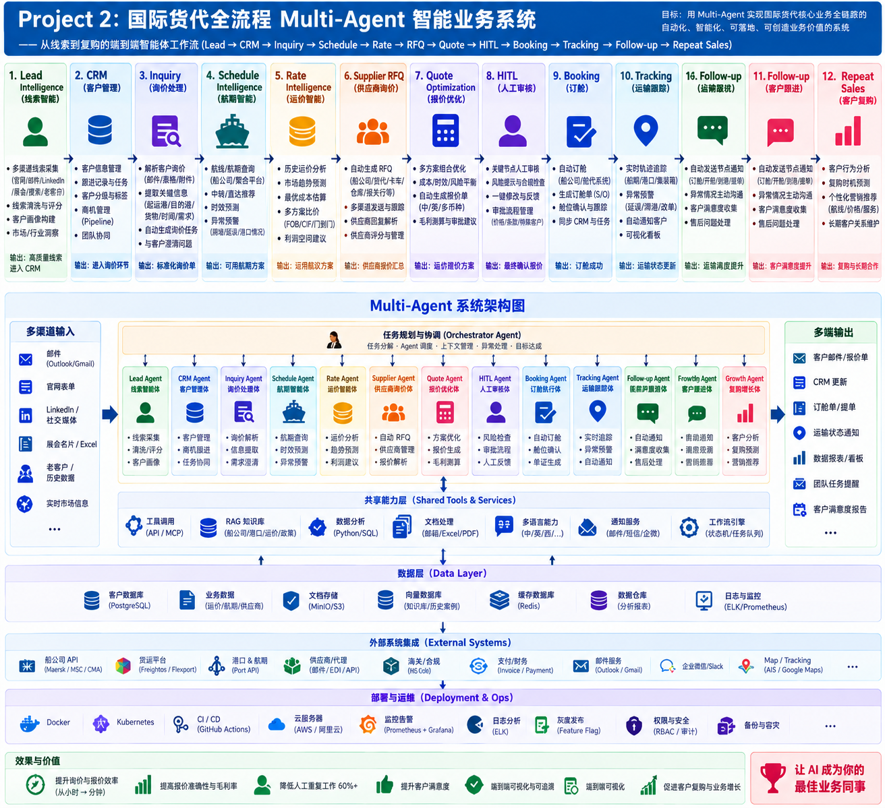

# AI Freight Forwarder — Multi-Agent Business Platform

> 国际货代销售全链路：**主动获客 → 询价 → 航线/运价 → 供应商 RFQ → 报价优化 → 人工审批 → 订舱 → 船位跟踪 → 复购跟进**

[](https://github.com/1536605949/ai-freight-forwarder-multi-agent/actions/workflows/ci.yml)

**这是一个生产级参考实现（Release Candidate），不是聊天机器人 Demo。**

它要回答的问题是：当 Agent 真正进入一门**有金额、有对外承诺、有合规责任**的生意时，
哪些部分可以交给模型，哪些部分**必须**交给确定性代码，以及这条界线在代码里长什么样。



---

## 一分钟验证

不需要 LLM Key、不需要任何外部账号、不需要数据库服务：

```bash
git clone https://github.com/1536605949/ai-freight-forwarder-multi-agent.git
cd ai-freight-forwarder-multi-agent
python scripts/bootstrap_dev.py          # 建 venv + 装依赖 + alembic upgrade head + 种子（幂等，可重复执行）
python -m uvicorn app.main:app --port 8100

# 另开一个终端：
pytest -q                                # 单元 + 集成：325 passed
python evaluation/run_eval.py            # 行为评测：6/6 通过
python evaluation/knowledge_eval.py      # 检索评测：hit@3 95.5%，负例误答 0/12
python scripts/delivery_check.py         # 交付验收：44/44 通过
sha256sum -c SHA256SUMS.txt              # 完整性校验：全部 OK
```

想直接看 Agent 部分，不需要跑完整流程：

```bash
# 带引用的 SOP 回答（拒答也是合法结果）
curl -s localhost:8100/api/v1/knowledge/answer -H 'content-type: application/json' \
  -d '{"query":"甩柜了怎么处理"}' | python -m json.tool

# LangGraph 图编排：跑到人工闸门停下
curl -s localhost:8100/api/v1/graph/run -H 'content-type: application/json' \
  -d '{"inquiry_id":"<inq_id>"}' | python -m json.tool
```

打开 <http://localhost:8100/demo/overview.html>，点「运行完整流程」——
十步业务链路会一次跑通，**并在人工审批闸门处停下**。

### 当前实测状态

| 项目 | 结果 | 复现命令 |
|---|---|---|
| 单元 / 集成测试 | **325 passed** | `pytest -q` |
| 覆盖率 | **82%** 整体；v2.0 新增模块 **88%** | `pytest --cov=app --cov=worker --cov=evaluation` |
| 静态检查 | **ruff 全绿**（规则集见 `pyproject.toml`） | `ruff check app tests worker evaluation scripts` |
| 行为评测 | **6/6**，全部真实执行 | `python evaluation/run_eval.py` |
| SOP 检索评测 | **hit@1 90.9% / hit@3 95.5% / 负例误答 0** | `python evaluation/knowledge_eval.py` |
| 交付验收 | **44/44** | `python scripts/delivery_check.py` |
| API 路由 | **59** | `GET /docs` |
| 度量口径 | `GET /api/v1/metrics/agent`（p50/p95、token、成本、闸门分布） | 见下方「可观测性」 |
| 数据表 / 索引 | **24 / 43** | `alembic upgrade head` |
| 模块循环依赖 | **0** | `tests/test_architecture_asset.py` |

> 上述数字都是本仓库当前代码实测所得，不是目标值。跑一遍即可复核。
> CI 逐步执行 lint / tests / retrieval eval / packaging / checksums / manifest / migrations / smoke boot。

---

## 四条核心设计决策

整个工程的说服力集中在这四条上。每一条都有对应的代码位置和测试。

### 1. Agent 负责理解与生成；确定性代码负责金额、权限、状态、审批、发送

`app/services/pricing.py` 里没有 LLM 调用。供应商比价是 `supplier_score()` 的确定性函数，
报价是 `sell = cost + max(MINIMUM_MARGIN_USD, cost * DEFAULT_MARGIN_PCT)`。
Agent 只负责**生成给客户看的措辞**，提示词里明确写着「不得改变 Pricing Engine 数字」。

```python
# app/services/pricing.py —— 钱的算术不经过模型
best = min(quotes, key=supplier_score)
cost   = round(best.ocean_freight + best.surcharges, 2)
margin = round(max(s.minimum_margin_usd, cost * s.default_margin_pct), 2)
sell   = round(cost + margin, 2)
```

### 2. 门禁在服务层，不在编排层

`send_quote()` 自己检查审批状态，而不是依赖调用方记得检查：

```python
# app/services/approval.py
if q.status != 'approved':
    raise ValueError('approval_required')
```

这意味着**编排逻辑写错也越不过门禁**。`tests/test_orchestrator.py` 断言未审批时
流水线停在闸门、不产生任何面向客户的副作用。

### 3. 编排只排序，不授权

`app/services/orchestrator.py` 的十阶段流水线里，可逆的内部步骤（解析、查航线、查运价、发 RFQ、
收报价、比价）自动跑；一旦要**对外发信或花钱订舱**，立即停下并返回 `waiting_approval`。

```
parse → schedules → rates → rfq → supplier_quotes → optimize
      → ⟦hitl_review 闸门⟧ → ⟦quote_send 闸门⟧ → booking → vessel_tracking
```

恢复执行**复用同一条代码路径**（`start_stage='hitl_review'`），而不是另写一套 "continue" 实现——
两套实现一定会漂移。

### 4. 状态迁移显式化，且只进不退

`app/state_machine.py` 是状态的唯一真相来源。`app/enums.py` 只声明**有哪些状态**，
迁移图单独一个模块，因为「谁能接谁」是一条业务规则，不是词汇表。

```python
INQUIRY_TRANSITIONS = {
    READY:               {SCHEDULED, NEEDS_CLARIFICATION, CLOSED},
    SCHEDULED:           {WAITING_SUPPLIER_QUOTES, CLOSED},
    WAITING_SUPPLIER_QUOTES: {QUOTE_READY, WAITING_APPROVAL, CLOSED},
    WAITING_APPROVAL:    {APPROVED, REJECTED, CLOSED},
    APPROVED:            {SENT, CLOSED},
    SENT:                {BOOKED, CLOSED},
    BOOKED:              {CLOSED},
    CLOSED:              frozenset(),          # 唯一的汇点
}
```

`advance_status()` 幂等（重复投递是静默 no-op）且**只进不退**（回退一律报错）。

这条规则修掉了一个真实缺陷：`PATCH /api/v1/inquiries/{id}` 曾经会把已订舱（`booked`）的询价
**倒回** `ready`。现在终态询价的内容被冻结（返回 409 `inquiry_locked`），
在途询价改字段也不再动状态。

---

## 这个仓库最值得看的一点：门禁是**双层**的

如果只是「服务层有个 if」，那是单点防御。这里有意做成两层，并且**实测验证过**：

把 `send_quote()` 的审批检查注释掉（模拟有人改错），整个系统仍然拦住了这次发送：

```
FAIL hitl1      refusal did not cite approval_required:
                {'detail': 'illegal_status_transition: waiting_approval -> sent (quote.send)'}
5/6 passed; critical: 5/6 ok, 1 failed, 0 not executed
EXIT=1
```

第二层（状态机）发现询价想从 `waiting_approval` 直接跳到 `sent`，而中间少了 `approved` 这一步，
于是拒绝。**两层独立生效**，且评测脚本 `exit 1` 让 CI 失败。

`tests/test_eval_harness.py` 用注入式假客户端把这类变异固化成回归测试——
一个**不能失败**的评测脚本比没有评测脚本更危险，因为它制造虚假信心。

---

## 从业务流水线到 Agent 系统（v2.0）

v1.0 是一个**有 Agent 角色的业务流程引擎**：状态机、确定性定价、审批闸门都在，
但编排是固定循环，没有条件分支，没有检索，没有模型选工具。v2.0 补的是这三件事，
而且每一件都接进了**真实执行路径**，不是旁挂的示例。

### 1. LangGraph 条件路由与可恢复的闸门

`app/services/orchestrator.py` 是线性阶段循环；`app/graph/` 是带分支的状态图。
图解决的是线性循环做不到的四件事：

| 场景 | 线性循环 | 状态图 |
|---|---|---|
| 询价字段不全 | 走完全部阶段再失败 | `understand → clarify` 立即停，返回缺失字段 |
| 供应商报价不足 | 用 1 条报价就定价 | `supplier_quotes` 停，`waiting_supplier_quotes` |
| 人工审批 | 抛异常中断 | `hitl_review` 节点两个出口，`waiting_approval` |
| 审批后继续 | 另写一条「继续」代码 | 条件入口点从停止的节点重新进入 |

```python
graph.add_conditional_edges(
    'supplier_quotes', _next('optimize'), {'optimize': 'optimize', END: END})
graph.set_conditional_entry_point(_entry, {n: n for n in ENTRY_NODES})
```

**没有用内存 checkpointer，这是有意的。** 一张报价单可能等审批两小时，中间会经历一次
发布；内存里的 checkpoint 必然丢失。所以持久化的是 `pipeline_graph_runs` 里的**游标**，
业务状态仍然只存在于领域表里——避免出现第二个真相来源。

写测试时抓到一个真实缺陷：`quote_send` 用的是普通边而不是条件边，所以审批闸门失败后
图**仍然继续去订舱**，只在订舱处才第二次失败。`test_resume_without_approval_fails_at_the_gate_and_does_not_send`
现在守住这一点。

### 2. SOP 知识库：带引用的回答与**明确的拒答**

`app/knowledge/` 是一套完整的检索链路：标题感知切片 → 向量 + BM25 → 融合 → 重排 →
有界打分 → 抽取式作答 + 引用。

真正花时间的不是「能答」，而是「知道什么时候不答」。第一版用 RRF（倒数排名融合）打分，
结果 `公司食堂几点开饭` 拿到 0.67 —— 因为 RRF 只看**名次**，而任何语料里总有一个排第一。
最终把两件事拆开：

- **排序**：BM25 + 余弦 + RRF，负责谁更相关；
- **充分性**：idf 加权词覆盖 + 词法强度 + 余弦构成的**绝对分**，不依赖语料里还有什么。

再叠一道**域外门**：查询里有多少字被语料认识的领域词覆盖。低于 35% 直接返回空，
根本不进入打分。这样 `员工年假有多少天`、`Python 的 GIL 是什么` 在门口就被拒掉。

实测（`evaluation/knowledge_eval.py`，22 正例 / 12 负例）：

| 指标 | 结果 |
|---|---|
| hit@1 | **90.9%** |
| hit@3 | **95.5%** |
| MRR | **0.932** |
| 负例误答 | **0 / 12** |

> 22 条正例的 95% 是**回归护栏**，不是质量保证。脚本会把样本量一起打印出来，
> 就是为了防止有人把它读成「检索准确率 95%」。

默认 embedding 是**确定性的哈希向量**，不是神经模型：无需 Key、可离线、可复现。
它本质是平滑过的词法匹配，跨不过「滞箱费 ↔ demurrage」这类同义改写——
这也是 `EMBEDDING_PROVIDER=openai` 存在的理由。**这一点写在代码注释里，不藏着。**

### 3. 受控工具调用

`app/agents/tools.py` 是工具注册表，`app/agents/tool_loop.py` 是有步数上限的循环。

安全边界不在提示词里，在**分发路径**里：

```python
if not spec.read_only:
    raise ToolError('tool_not_permitted', f'{name} is not read-only')
```

即使将来有人注册了一个写工具，模型也无法通过「选择它」来调用——除非有人同时改这个函数
和它的测试。当前 5 个工具全部只读且强制租户隔离，猜一个 id 只会得到 `not_found`。

循环最多 4 步（`AGENT_MAX_TOOL_STEPS`），被拒绝的调用**记录但不重试**：
重试一个权限错误就是把错误变成死循环。

### 4. 超时、重试与成本计量

`app/agents/resilience.py`：

- 每次模型调用有超时（`LLM_TIMEOUT_SECONDS`），超时转成可重试失败；
- 重试**只对瞬态故障**生效，`ValueError`（业务拒绝）不重试——重试它只是重复烧钱；
- token 从两种 provider 形态里提取，成本按配置单价计算；**没上报就记 NULL，不记 0**。
  记 0 会让「平均每次成本」这个指标永远好看，从而失去意义。

### 5. 可观测性：把这些字段读回来

上面第 4 条写过「没上报就记 NULL」。但只写不读的字段和不会失败的测试是同一种问题——
看起来有可观测性，却回答不了任何问题。`app/services/metrics.py` 是那个读取方，
`GET /api/v1/metrics/agent?days=7` 是出口：

```bash
curl -s "localhost:8100/api/v1/metrics/agent?days=7" -H 'X-Demo-Tenant: tenant-demo' \
  -H 'X-Demo-User: u1' | python -m json.tool
```

返回两块，全部是已有行上的算术，没有一次模型调用：

| 块 | 内容 |
|---|---|
| `agents` | 每次运行耗时 p50/p95/max、token 汇总、成本、按 agent 拆分的失败数 |
| `graph` | 每个节点的 p50/p95、`stop_reason` 分布、`node:status` 计数、有计时的运行数 |

三条口径写在代码里，也写在测试里：

- **未上报 ≠ 0**。没有 token 的运行计入 `unreported_runs` 并**排除**在均值之外，
  分母是「真正上报了的运行数」（`per_reported_run`），不是全部运行数。
- **百分位是 nearest-rank，不插值**。只有几次运行的时候，插值出来的 p95 是一个
  谁都没观测到的数字。空样本返回 `null`，不返回 0。
- **窗口会被夹住**（上限 90 天），否则一个开着不关的看板就能把整张表扫一遍。

节点耗时记录在 `_guarded` 包装器里而不是各个节点内部：这样新增一个节点不会忘记加计时，
**失败路径也会被计时**——跑 30 秒才失败的那个节点才是最该看见的。

---

## 快速开始

### 一键（推荐）

```bash
python scripts/bootstrap_dev.py      # 幂等：检查 Python → 建 venv → 装依赖 → 建表 → 种子 → 自检
python -m uvicorn app.main:app --port 8100
```

常用参数：

```bash
python scripts/bootstrap_dev.py --check          # 只体检，不修改任何文件
python scripts/bootstrap_dev.py --skip-install   # venv 已就绪时跳过 pip
python scripts/bootstrap_dev.py --reset-db       # 重建数据库
```

### 手工等价步骤

```bash
python -m venv .venv
source .venv/bin/activate            # Windows: .venv\Scripts\activate
pip install -r requirements-dev.txt
cp .env.example .env                 # 默认值即可跑通，无需任何凭证
python -m alembic upgrade head       # 建表
python scripts/seed_demo.py
uvicorn app.main:app --reload --port 8100
```

打开 <http://localhost:8100/docs> 查看 OpenAPI，或运行：

```bash
python scripts/demo_scenario.py      # 脚本化演示
python scripts/acceptance.py         # 端到端冒烟
```

---

## 一键跑完整流程（Orchestrator）

```bash
# 1. 投递一封询价邮件（ETD 是必填项，缺失会停在 needs_clarification）
curl -X POST http://localhost:8100/api/v1/messages/inbound \
  -H 'X-Demo-User: demo' -H 'X-Demo-Tenant: tenant-demo' -H 'Content-Type: application/json' \
  -d '{"external_message_id":"m1","sender_email":"buyer@acme-import.com","subject":"quote",
       "body":"Need 1x40HQ Shanghai to Los Angeles, ETD 2026-09-25"}'

# 2. 一键跑到闸门（返回 status=waiting_approval 与 pending.quote_id）
curl -X POST http://localhost:8100/api/v1/orchestrate/run \
  -H 'X-Demo-User: demo' -H 'X-Demo-Tenant: tenant-demo' -H 'Content-Type: application/json' \
  -d '{"inquiry_id":"inq_xxx"}'

# 3. 人工审批后继续（需 reviewer 角色）
curl -X POST http://localhost:8100/api/v1/orchestrate/continue \
  -H 'X-Demo-User: demo' -H 'X-Demo-Tenant: tenant-demo' -H 'Content-Type: application/json' \
  -d '{"quote_id":"cq_xxx","vessel_name":"MAEU-VESSEL"}'
```

要点：

- **未审批时调用 `/continue` 不会绕过闸门**——它返回 `waiting_approval`，什么也不做。
- **重复运行安全**：不会重复开 RFQ，不会重复订舱。
- 只读快照 `GET /api/v1/orchestrate/status/{inquiry_id}` 返回当前卡在哪一步（`waiting_on`）。
- `auto_approve` 仅用于演示/测试，**必须显式传参**，不读环境变量——避免在生产配置里被误开。
- 每次运行返回逐步轨迹（阶段名 + 状态 + 产出物 id），前端无需理解业务即可渲染进度。

---

## 演示页面

仅在 `ENVIRONMENT != production` 时挂载，不属于业务 API 面。
一条主链路 + 三个可单独验证的能力面，`/demo/` 是统一入口。

| 页面 | 地址 | 内容 |
|---|---|---|
| 首页 | `/demo/` | 四张入口卡，每张写明前置条件与首次运行步骤 |
| 业务闭环 | `/demo/overview.html` | 十阶段流水线一键跑通，含人工闸门交互 |
| 图编排控制台 | `/demo/graph.html` | 11 节点条件图：缺字段追问、报价不足等待、人工闸门，停在哪就从哪续跑 |
| 知识台 | `/demo/knowledge.html` | SOP 检索作答（带引用）、**域外问题明确拒答**、工具调用轨迹、运行度量 |
| 主动获客 | `/demo/prospecting.html` | 搜客户 → 画像 → 开发信 → 三道合规门禁 |

页面之间共享 `demo_client/theme.css`（同一套配色与组件），顶栏互链。
设计与评估口径见 [`docs/UI_DESIGN.md`](docs/UI_DESIGN.md)。

三层守卫，缺一层都会退化成「看起来有页面」：

| 层 | 位置 | 守什么 |
|---|---|---|
| 契约 | `tests/test_demo_contract.py` | 页面阶段元数据与 `orchestrator.STAGES` 逐字一致 |
| 契约 | `tests/test_demo_pages.py` | 节点名与 `graph/builder.NODES` 逐字一致、元素 id 可解析、端点名存在 |
| 运行时 | `scripts/page_smoke.js` + `tests/test_page_runtime.py` | jsdom 里真跑内联 JS、真点按钮、真读 DOM（node + jsdom 缺失时 skip 并说明原因） |

前两层是静态解析——它们能证明页面**提到**了 `hitl_review`，证明不了页面**渲染得出来**。
这个仓库已经为这个区别付过一次代价（259 个测试全绿，同时第一次真实请求 500），
所以第三层是必需的，不是锦上添花。

---

## 主动获客与合规

从「等客户上门」扩展为「主动找客户」：

```
ProspectingSource (可插拔)
   → Prospecting Agent  (按航线评估匹配度)
   → Enrichment Agent   (客户画像 + 决策人角色)
   → Cold Outreach Agent(生成开发信)
   → 人工审批 + 四道代码级门禁
   → Lead → 进入询价报价流程
```

**四道代码级门禁**（`app/services/prospecting.py`，提示词无法绕过）：

| # | 门禁 | 失败码 |
|---|---|---|
| 1 | 必须已记录人工批准 | `approval_required` |
| 2 | 必须有合法处理依据（`opt_in` / `legitimate_interest_reviewed`） | `compliance_basis_required` |
| 3 | 匹配度不低于下限（`OUTREACH_MIN_SCORE`，默认 70） | `score_below_outreach_threshold` |
| 4 | 未超过触达频率上限（默认 30 天内 2 次） | `frequency_cap_exceeded` |

顺序有讲究：1、2 是授权与合法性，3、4 是反滥发的运营策略。低分线索**仍然可以生成草稿**
——起草不产生外部副作用，发送才会——但发送会被拒，且被拒后记录仍停在 `approved`。

另支持 `POST /api/v1/outreach/opt-out` 一键退订，立即在候选池、Lead、未发出草稿三处生效。

**数据能不能核验，如实说**：`GET /api/v1/prospects/{id}/evidence` 返回四级判断
（`synthetic` / `placeholder` / `traceable` / `openable`）。Mock 源写的是 `.example` 保留域，
**永远不会解析**，所以它被标成 `synthetic` 且不给出链接——伪造一个点开是 404 的「来源」
比诚实地说「无法核验」更糟。

规则 → 强制点 → 测试的完整对照见 [`docs/OUTREACH_COMPLIANCE.md`](docs/OUTREACH_COMPLIANCE.md)，
同类项目调研见 [`docs/GITHUB_LANDSCAPE.md`](docs/GITHUB_LANDSCAPE.md)。

**数据怎么进来**（真实获客的第一步，不是搜索而是导入）：

```bash
# 数据商给的是 CSV 导出，不是一个 REST API
curl -X POST http://localhost:8100/api/v1/prospects/import \
  -d '{"source":"tradesns","data_origin":"vendor_contract_2026","format":"csv",
       "content":"公司,国家,行业,货量,邮箱\n铁杉贸易,德国,机械,260,ops@tsuga.test\n"}'
# → {"accepted":1,"rejected":0,"reasons":{}}

curl -X POST http://localhost:8100/api/v1/prospects/prs_xxx/score
# → {"verdict":"qualified","score":90.0}
```

- `source` / `data_origin` **必填**——一份说不出从哪来的名单，正是不能合法发信的那份。
- 表头做映射（`Est Volume TEU` / `teu` / `货量` 同义），否则货量静默变 `None`、被打成低货量线索。
- 双键去重：`(source, source_ref)` 防重导，`(归一化公司名, 邮箱)` 防两家供应商买到同一家。
- **导入 ≠ 合格**：落库是 `status=imported` / `score=0`，评分下限直接挡住群发。

**中国海关数据的两件特殊事**（只做中国起运时必然遇到）：

- **一行两个主体**：`出口商` + `采购商`。谁是线索取决于你卖什么，所以由调用方选边——
  `entity_side: "exporter"`（默认，卖中国起运）或 `"importer"`（卖进中国）；
  另一边存为 `counterparty`，HS / 金额 / 数量 / 日期原样存进 `shipment_facts`。
- **没有邮箱**。导入结果直接给 `contact_gaps: {emailable, no_email, no_contact_name}`，
  全都没邮箱时附一句说明——「买了 1 万家客户」和「能给 1 万家发信」之间隔着整个富化环节，
  这个数字要在付钱之前看到，而不是在起草时一条条撞墙。

> 公司名归一化必须保留非 ASCII 字符。此前用 `[^a-z0-9]` 折叠，**所有中文公司名都变成空串**，
> 第二家中国公司会被当成第一家的重复项**静默丢弃**——导一份真实中文 CSV 才暴露出来。

Panjiva 怎么获取、中国侧数据源、只买中国模块怎么谈、合同必须写的八条，见
[`docs/DATA_SOURCING_CN.md`](docs/DATA_SOURCING_CN.md)；
六类数据源与四条已知缺口见 [`docs/ACQUISITION_PLAYBOOK.md`](docs/ACQUISITION_PLAYBOOK.md)。

> **数据来源合规**：中国大陆海关提单数据不对普通企业开放，仅可通过持牌数据商获取；
> AIS 船位为付费授权数据。仓库内 `MockProspectingSource` 与 mock AIS 均为**合成数据**，
> 仅供演示（`data_origin=mock_synthetic`）。生产接入须取得相应许可，不得爬取。

---

## 船舶位置与主动延误预警

```
VesselPositionProvider (AIS Adapter) → 位置快照落库 → 延误判定
                                        → 超阈值生成 FollowUpTask 主动通知客户
```

```bash
curl -X POST "http://localhost:8100/api/v1/vessels/MV%20EVER%20GIVEN/refresh?voyage=024E&booking_id=bkg_xxx"
curl "http://localhost:8100/api/v1/vessels/MV%20EVER%20GIVEN/history"
```

- 位置快照保存在 `vessel_positions`——**有历史才能判断延误是否在扩大**，单次查询只能回答「现在在哪」。
- 按 `booking_id` 去重：同一订舱的延误预警只生成一条未关闭任务，不会被轮询刷爆。
- 无订舱不预警（没有可通知的客户，不凭空猜）。
- 客户 `do_not_contact` 时抑制预警。
- 阈值 `VESSEL_DELAY_ALERT_HOURS`（默认 12 小时）。

---

## 切到真实 LLM

默认 `AGENT_PROVIDER=mock`：确定性 mock runtime，**无 Key 也能完整跑通业务状态机**。
这是刻意的——业务正确性不应该依赖模型是否可用。

```bash
pip install -r requirements-agent.txt      # agent-framework 是可选项，不在 requirements.txt 里
export AGENT_PROVIDER=maf_openai
export OPENAI_API_KEY=...
export OPENAI_CHAT_MODEL=...
```

`MockAgentRuntime` 与 `MicrosoftAgentFrameworkRuntime` 实现同一个 `AgentRuntime` 接口，
所以切换 provider 不会触碰业务层。

> `requirements.txt` **刻意不包含** `agent-framework`：把它塞进必装依赖会让 Docker 构建和
> 所有普通安装一起失败。`tests/test_packaging.py` 会守住这条不变量。

---

## 生产边界（诚实清单）

这一节比上面任何一节都重要。以下都是**已知**的，不是没想到。

### 必须替换才能上生产

| 项 | 现状 | 生产要求 |
|---|---|---|
| 所有 Provider | `Mock*Provider`，确定性合成数据 | 接入真实 Carrier / DCSA / 合约价 / AIS，并取得商业授权 |
| 认证 | `AUTH_MODE=dev` 信任 `X-Demo-*` 头 | 必须 `jwt` + 真实密钥；demo 头在 jwt 模式下已被忽略（有测试） |
| 数据库 | SQLite（演示）/ Postgres（compose） | Postgres + 连接池 + 备份策略 |
| 密钥 | `.env` 明文默认值 | 密钥管理服务 |

### 已知技术债

- `worker/scheduler.py` 的 `process_due()` **没有行级锁**（`SELECT ... FOR UPDATE SKIP LOCKED`）。
  多副本部署前必须补，否则同一任务会被处理两次。
- `RFQ.expires_at` 已写入但**未被读取**——RFQ 超时目前没有自动恢复。
- `OutboxEvent` 只写不读，尚无消费者。
- `app/agents/maf_workflows.py` 是**未接线的参考实现**（3 个 workflow 工厂，0 调用点）。
  模块顶部已标注 `NOT WIRED`，`tests/test_maf_workflows.py` 把这一状态固化为测试，
  避免它悄悄烂成「看起来能用」。
- `deployment/docker-compose.yml` 声明了 `redis`，但代码中 0 引用。
- 对**提示词注入**没有专门防御：当前设计把 LLM 输出限制在「生成措辞」，
  金额与状态不经过模型，但这不等于攻击面为零。
- `InquiryPatch` 用 `None` 表示「未提供」，因此**无法通过 PATCH 清空某个字段**（需传空字符串）。
- **默认 embedding 是哈希向量，不是语义模型。** 它能处理词形重叠，跨不过同义改写
  （「滞箱费」↔「demurrage」）。检索质量数字是**词法检索**的数字，不要读成语义检索。
- **重排是手写公式，不是 cross-encoder。** `retrieval.rank()` 用词覆盖 + 标题命中 +
  词法强度，不是学习出来的 reranker。上真实 reranker 是下一步，不是已完成项。
- **没有 MCP server。** 工具注册表是进程内的，协议层未实现。
- **没有微调。** 仓库里没有 SFT/LoRA/QLoRA 的任何代码或数据；mock 解析器是规则，不是模型。
- **图编排没有 checkpointer。** 刻意如此（见上文），代价是：一个进程内正在执行的图
  无法在**节点中途**被暂停并原样续跑；续跑的单位是节点边界。这足够覆盖人工审批，
  不足以覆盖「长事务内的任意中断」。
- **成本字段依赖 provider 上报。** 未配置单价时 `cost_usd` 记 NULL；真实数字需要
  接一个会上报 token 的 provider。

完整的架构审查（含证据与修复优先级）见 [`docs/ARCHITECTURE_REVIEW.md`](docs/ARCHITECTURE_REVIEW.md)。

---

## 项目结构

```
app/
  main.py            59 条路由；鉴权、错误码映射、demo 页面挂载
  state_machine.py   InquiryStatus 迁移图 + advance_status()（唯一真相来源）
  enums.py           状态词汇表
  models.py          23 张表（全部带 tenant_id）
  schemas.py         Pydantic 输入契约
  config.py          58 个配置项（与 .env.example 逐项对齐，有测试守）
  auth.py            dev 头 / JWT 双模式 + require_role()
  services/          确定性业务层：inquiry / schedule / rates / rfq / pricing /
                     approval / booking / tracking / vessel / followup /
                     prospecting / orchestrator
  graph/             LangGraph 状态图：条件路由、可恢复闸门、游标持久化
  knowledge/         SOP 切片 / 向量 / BM25 / 融合重排 / 带引用作答 + 拒答
  agents/            runtime（mock ↔ MAF 同接口）、tools（只读注册表）、
                     tool_loop（有界循环）、resilience（超时/重试/token）、
                     specialists、prompts、maf_workflows
  providers/         rates / schedule / booking / tracking / email / prospecting / vessel
                     （Protocol + Mock 实现 + 真实厂商骨架）
worker/scheduler.py  跟进任务轮询（支持 --once 用于 cron）
evaluation/          行为评测（run_eval.py）+ 检索评测（knowledge_eval.py）
migrations/          Alembic；0001/0002 均为显式冻结快照
demo_client/         静态演示页
tests/               325 个测试
docs/                架构、分层、集成、交付、审查文档
```

### 分层依赖方向

```
main (HTTP)  →  services (确定性业务)  →  models / providers
                      ↑
              agents (LLM，可选)
```

`app/providers/*` 对 `models` / `services` 有 **0 反向依赖**——适配层可以被单独替换或测试。

---

## 关于迁移

`migrations/versions/0001_initial.py` 是一份**显式写出的 DDL 冻结快照**，不是
`Base.metadata.create_all()`。

这个区别是实质性的：如果迁移去 introspect 当前模型，那么**改一个模型就会悄悄改变同一个
revision 产出的 schema**——两个都升到 `0001_initial` 的库互相不一致，却都报告成功，
而原始 schema 已经无法从代码里恢复。显式写出就把它冻住了。

`tests/test_migrations.py` 守住真正重要的不变量：**空库升到 head 后的 schema 必须与 ORM 声明完全一致**
（表、列、可空性、主键、唯一约束），并且 `downgrade base` 不留残余、重复升降级结果可复现。

### 本地引导也走 alembic，不走 create_all

`scripts/bootstrap_dev.py` 建库时执行的是 `alembic upgrade head`，**不是** `Base.metadata.create_all()`。

这是一个真实踩过的坑：`create_all()` 会把表全部建出来，但**不会写 `alembic_version` 行**。
于是本地库看起来完全健康，而下一次 `alembic upgrade head`——也就是生产路径——会直接死在
`table agent_runs already exists`。根因是**schema 有两个真相来源**，而先漂移的那个永远是没被测的那个。

现在引导与生产走同一条代码路径；`tests/test_migrations.py` 用 AST 断言 `bootstrap_dev.py`
里不存在 `create_all` 调用，并断言它确实 shell out 到 `alembic upgrade head`。

老库（此前用 `create_all` 建的）会被明确识别并给出两条出路，而不是抛一句原始 alembic 报错：

```
ERROR: this database was created before alembic owned the schema
       (its tables exist but there is no alembic_version row)
HINT : If it holds nothing you need, rebuild it:
       `python scripts/bootstrap_dev.py --skip-install --reset-db`.
       Otherwise, having confirmed the schema is current, adopt it with `alembic stamp head`.
```

刻意**不**自动 stamp：只有操作者能判断那个 schema 是否真的等于 head，
自动 stamp 会把真实漂移悄悄掩盖过去。

### 应用启动时也不再建表

引导脚本改到 alembic 之后，`app/main.py` 的启动钩子仍然留着
`Base.metadata.create_all(engine)`（非生产环境）。它看起来只是方便，实际是**最后一个
第二真相来源**，而且失败方式极难归因：

- `create_all` 只补建缺失的**表**，从不给已存在的表加**列**。所以某个迁移一旦新增列，
  跑过旧版本的人就永久缺这一列，症状是 `no such column: agent_runs.prompt_tokens` ——
  看起来像查询写错了。
- 它建出来的库没有 `alembic_version` 行，于是「修复」动作 `alembic upgrade head`
  会死在 `table agent_runs already exists`。**用来救场的手段被造成问题的东西挡住了。**

v2.0 开发期间这两种情况都真实发生过。现在启动时只做检查
（`app/schema_guard.py`）：不在 head 就**拒绝启动**并给出确切命令。

```python
# app/main.py
@app.on_event('startup')
def startup():
    ensure_schema(engine)      # 不在 head 就抛 SchemaNotReady，附带修复命令
```

刻意**不**在启动时自动升级：进程启动时改 schema，在滚动发布里两个实例会抢同一批 DDL。
同一条规则也适用于另外两个入口：`worker/scheduler.py` 和 `scripts/seed_demo.py`
原本也各自 `create_all`（先起 worker 再迁移，同样会造出 alembic 接管不了的库），
现在都改成 `ensure_schema`。

`tests/test_schema_guard.py` 覆盖三种拒绝情形（无 schema / create_all 建的库 / 落后一个
revision），并用 AST 扫过 `app/`、`worker/`、`scripts/` 全部文件，断言不再出现
`create_all`/`drop_all`——扫描整片运行时代码，而不是只盯 `main.py`。

**启动即拒绝**比「起来了但 schema 是旧的」更好：前者是一条命令的修复，后者是几小时的排查。

---

## 文档索引

| 文档 | 内容 |
|---|---|
| [`docs/ARCHITECTURE_LAYERS.md`](docs/ARCHITECTURE_LAYERS.md) | 分层职责与硬门禁清单 |
| [`docs/ARCHITECTURE_REVIEW.md`](docs/ARCHITECTURE_REVIEW.md) | 架构审查：模块职责、依赖、数据流、薄弱环节与修复优先级 |
| [`docs/AGENT_DESIGN.md`](docs/AGENT_DESIGN.md) | Agent 边界与提示词策略 |
| [`docs/UI_DESIGN.md`](docs/UI_DESIGN.md) | 演示界面：现状评估、优化方案、每个页面的功能区与交互流程 |
| [`docs/OUTREACH_COMPLIANCE.md`](docs/OUTREACH_COMPLIANCE.md) | 获客外联：规则 → 强制点 → 测试三列对照 |
| [`docs/ACQUISITION_PLAYBOOK.md`](docs/ACQUISITION_PLAYBOOK.md) | 获客数据从哪来：六类数据源、三条进入路径、四个坑与对策 |
| [`docs/DATA_SOURCING_CN.md`](docs/DATA_SOURCING_CN.md) | 只做中国业务：Panjiva 获取路径、中国侧数据源、只买中国模块怎么谈、合同八条 |
| [`docs/GITHUB_LANDSCAPE.md`](docs/GITHUB_LANDSCAPE.md) | 同类项目调研：检索记录、可借鉴清单、方法局限 |
| [`docs/INTEGRATIONS.md`](docs/INTEGRATIONS.md) | 外部系统接入（含运价数据的硬约束） |
| [`docs/DELIVERY_STEP1.md`](docs/DELIVERY_STEP1.md) | 第一步交付状态与验收口径 |
| [`docs/PRODUCTION_GAPS.md`](docs/PRODUCTION_GAPS.md) | 距离生产还差什么 |
| [`docs/SECURITY.md`](docs/SECURITY.md) | 安全与合规边界 |
| [`HOW_TO_RUN.txt`](HOW_TO_RUN.txt) | 纯文本运行手册 |

---

## License

见 `LICENSE`。仓库内所有 Mock Provider 产出均为**合成数据**，不含任何真实客户、真实运价或个人信息。
